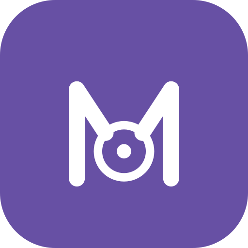
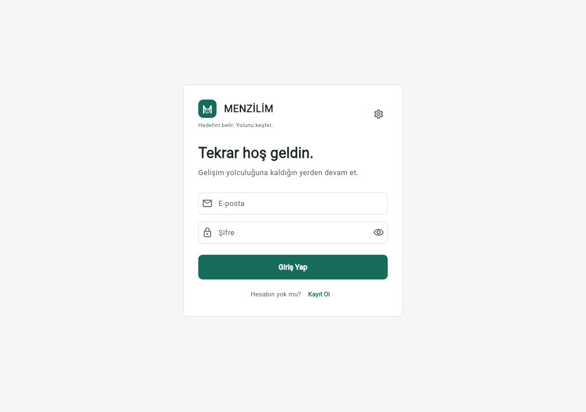
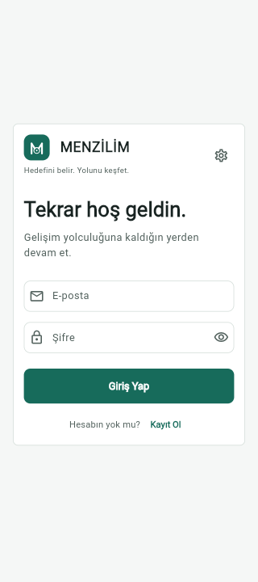

<p align="center">
  
</p>

<h1 align="center">MENZİLİM</h1>

<p align="center">
  <strong>Hedefini belir. Yolunu keşfet.</strong><br>
  Kariyer hedefini günlük adımlara ve gerçek bir projeye dönüştür.
</p>

<p align="center">
  <a href="#ekran-görüntüleri">Ekran görüntüleri</a> ·
  <a href="#özellikler">Özellikler</a> ·
  <a href="#mimari">Mimari</a> ·
  <a href="#yerel-kurulum">Yerel kurulum</a> ·
  <a href="#test-ve-build">Test ve build</a>
</p>

<p align="center">
  
  
  
  
  
</p>

---

## MENZİLİM nedir?

MENZİLİM, kariyer hedefini uygulanabilir bir gelişim yoluna dönüştürmeye yardımcı olan kişisel profesyonel gelişim platformudur. Kullanıcı hedefini ve uzmanlığını belirler; uygulama günlük öğrenme adımları, beceri görünümü ve adım adım ilerleyen bir proje ile bu yolculuğu destekler.

**Hedef → Yol → Bugün → Öğren → Uygula → Üret → Ölç → Geliş**

## Ekran görüntüleri

Görüntüler, repository'deki Flutter Web release build'inden alınmıştır.

<p align="center">
  
</p>

<p align="center"><em>Masaüstü · Giriş</em></p>

<p align="center">
  
</p>

<p align="center"><em>Mobil · 400 CSS px</em></p>

## Özellikler

| Alan | Kullanıcıya sağladığı değer |
| --- | --- |
| Kişisel başlangıç | Meslek, uzmanlık, deneyim, kariyer hedefi ve günlük süreye göre onboarding |
| Bugün | Günlük öğrenme planı, süre ve görev ilerlemesi |
| Yolum | Kullanıcının hedefi, beceri açığı ve adım adım gelişen proje |
| Öğrenme kataloğu | Uzmanlığa göre içerik keşfi, içerik ilerlemesi ve öneriler |
| Uygulama | Proje adımları, tamamlanma ve isteğe bağlı kanıt bağlantısı/notu |
| Beceri ve ilerleme | Beceri seviyeleri, quiz sonuçları, görevler ve günlük özetler |
| Quiz | Uzmanlığa göre quiz, cevap açıklamaları ve sonuç özeti |
| AI Koç | Soru-cevap deneyimi; varsayılan sağlayıcı mock, Anthropic yapılandırılabilir |
| Gündem | Uzmanlıkla eşleşen teknoloji haberleri ve orijinal kaynak bağlantısı |
| Kişiselleştirme | Türkçe/İngilizce ve sistem/açık/koyu tema tercihleri |
| Oturum | JWT ile kayıt/giriş, kalıcı oturum, süresi dolan oturum ve çıkış yönetimi |

## Mimari

```text
menzilim/
├── apps/menzilim_app/             Flutter Web, Android ve iOS istemcisi
│   └── lib/
│       ├── core/                  Tema, localization, auth, API ve design system
│       └── features/              Dashboard, projects, quiz, news, skills, ...
└── backend/
    ├── Menzilim.Domain/           Domain modelleri
    ├── Menzilim.Application/      DTO'lar, servisler ve iş kuralları
    ├── Menzilim.Infrastructure/   EF Core, SQL Server, repository ve seed
    ├── Menzilim.Api/              ASP.NET Core Minimal API
    └── Menzilim.Tests/            xUnit backend testleri
```

Flutter istemcisi ASP.NET Core API ile HTTP/JSON üzerinden haberleşir. Backend; Domain, Application, Infrastructure ve API katmanlarına ayrılmış modüler monolith yapısını kullanır. SQL Server erişimi EF Core üzerinden yapılır.

## Teknolojiler

- **Backend:** .NET 10, ASP.NET Core Minimal API, EF Core 10, SQL Server, JWT
- **Frontend:** Flutter 3.47.4 ile doğrulandı, Dart 3.13.3, Material 3
- **Uygulama:** Clean Architecture yaklaşımı, feature bazlı Flutter modülleri
- **Yerel ayarlar:** `shared_preferences` ile tema/dil ve istemci oturumu
- **AI:** Mock provider varsayılan; Anthropic provider isteğe bağlı yapılandırılır
- **Dil ve tema:** Türkçe/İngilizce; System/Light/Dark

## Yerel kurulum

### Gereksinimler

- .NET SDK 10
- Dart SDK `3.13.3` veya uyumlu Flutter SDK (bu repository Flutter `3.47.4` ile doğrulandı)
- Windows'ta SQL Server LocalDB. Farklı işletim sistemlerinde erişilebilir bir SQL Server bağlantısı gerekir.
- Web'i Chrome'da çalıştırmak için Google Chrome

### 1. Repository'yi al

```powershell
git clone https://github.com/Keremcanatass/menzilim.git
cd menzilim
```

### 2. Backend'i yapılandır ve başlat

Uygulama `http://localhost:5205` adresinde başlar. İlk çalıştırmadan önce veritabanı migration'larını uygulayın; API başlangıçta katalog seed verilerini ekler ancak migration'ları kendisi çalıştırmaz.

```powershell
cd backend

# dotnet-ef kurulu değilse bir kez kurun
dotnet tool install --global dotnet-ef --version 10.0.12

# API imzalama anahtarını User Secrets'ta saklayın (en az 32 karakter)
dotnet user-secrets set "Jwt:Key" "replace-with-a-long-random-secret-key" --project Menzilim.Api

# İlk veritabanı kurulumu / bekleyen migration'lar
dotnet ef database update --project Menzilim.Infrastructure --startup-project Menzilim.Api

# API'yi başlatın
dotnet run --project Menzilim.Api --launch-profile http
```

API health check: `http://localhost:5205/`
Development OpenAPI: `http://localhost:5205/openapi/v1.json`

> SQL Server LocalDB, Windows'a özeldir. Başka bir işletim sisteminde `ConnectionStrings:DefaultConnection` değerini kullanılabilir SQL Server adresinize göre yapılandırın. `appsettings.json` içine gerçek parola veya JWT secret koymayın.

### 3. Flutter Web'i başlat

Yeni bir terminalde repository kökünden:

```powershell
cd apps/menzilim_app
flutter pub get
flutter run -d chrome
```

Uygulama API için `http://127.0.0.1:5205` adresini kullanır. Backend'i Flutter'dan önce başlatın.

### AI Koç'u yapılandırma (isteğe bağlı)

Varsayılan `mock` provider dış servis anahtarı olmadan çalışır. Gerçek Anthropic yanıtları için API projesine User Secrets ekleyin:

```powershell
cd backend
dotnet user-secrets set "AIProvider:Provider" "anthropic" --project Menzilim.Api
dotnet user-secrets set "AIProvider:ApiKey" "your-anthropic-api-key" --project Menzilim.Api
```

## Test ve build

Repository kök dizininden:

```powershell
# Backend build ve test
dotnet build backend/Menzilim.slnx
dotnet test backend/Menzilim.slnx --no-restore

# Flutter analiz ve test
cd apps/menzilim_app
flutter analyze
flutter test

# Production Web çıktısı: apps/menzilim_app/build/web
flutter build web --release
```

## API alanları

API; auth, onboarding, dashboard, daily plan, içerik/öneriler, quiz, AI Coach, skills/skill gap, progress/streak, haber ve project akışlarını sunar. Kullanıcıya özel `/me` uçları JWT ile korunur. Endpoint uygulaması için `backend/Menzilim.Api/Program.cs` dosyasına bakın.

## Durum

Proje aktif geliştirme aşamasındadır. Yerel demo için kayıt akışını kullanın; repository içinde paylaşılmış varsayılan kullanıcı hesabı veya parola yoktur. Herkese açık dağıtım öncesi ortamınıza uygun SQL Server ve JWT secret yapılandırması yapın.

---

<p align="center"><strong>MENZİLİM</strong><br>Hedefini belir. Yolunu keşfet.</p>
